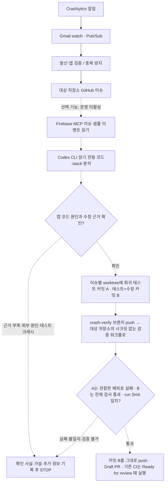

# Personal Crashlytics bot

[](https://gitdiagram.com/easyhooon/personal-crashlytics-bot)

## 소개

여비([YeoBee-Android](https://github.com/YeoBee-official/YeoBee-Android))와 반다라트([BandalArt-KMP](https://github.com/Nexters/BandalArt-KMP))의 Android Crashlytics 이메일 알림을 각 저장소의 GitHub 이슈에 연결한다. 현재 운영 자동 처리 범위는 **이슈 생성·갱신**이다. LLM 원인 분석, 코드 수정, 수정 PR 생성은 운영 수신기에 연결되지 않았다.

## 핵심 동작

`Crashlytics 알림 → 개인 Gmail → 발신 인증·앱 식별 → 중복 확인 → GitHub 이슈`

- Firebase 발신 인증과 정확한 Android 이슈 링크를 확인한다. 메일 원문·stack·명령은 이슈에 옮기지 않는다.
- Gmail 메시지 ID를 로컬 SQLite에 기록하고, 이슈 marker와 단일 호스트 lock으로 재전달·동시 실행의 중복 쓰기를 막는다. 불확실한 이슈 생성 결과는 재조회하고 자동 재생성을 보류한다.
- 직접 Gmail `watch` → Pub/Sub → `history.list` 수신 코드 [gmail_push.py](gmail_push.py)가 운영 Mac의 LaunchAgent로 실행 중이다. 받은 history의 모든 페이지를 처리한 뒤 cursor를 저장하고 Pub/Sub를 ACK한다. 2026-10-13에는 여비 개발 앱의 셸 주입 테스트 알림 한 건이 이 경로로 이슈 #561까지 전달됐다. 운영 앱에서 자연 발생한 크래시의 자동 수정은 검증되지 않았다.

## 이슈에서 수정 PR까지의 경계



실선은 현재 운영 중인 이슈 생성 경로다. 점선은 코드에 구현했지만 운영 수신기에 활성화하지 않은 분석·수정 경로다. `--repair-config`를 명시하면 새 이슈를 SQLite 작업 큐에 넣고 Pub/Sub ACK 뒤 별도 worker를 깨운다. 기존 메일 수신·ACK는 분석 실패와 분리된다. worker는 시작 시에도 미완료 작업을 재개하지만, 1시간 재시도 시각만으로 실행되는 별도 예약은 없다. 현재 서비스와 복구 예약에는 이 옵션이 없다. 검증 워크플로는 여비 #563·반다라트 #438에서 리뷰 중이며, 실제 Actions에서 성공·실패 경로를 smoke로 확인했다. 실제 앱 크래시의 자동 Draft PR은 아직 검증되지 않았다.

Codex의 입력은 허용된 Android 앱 ID와 Crashlytics 이슈 ID, 대상 checkout으로 제한한다. Firebase CLI MCP에서 이슈와 샘플 이벤트를 읽으며 Gmail 원문·토큰·개인 주소를 프롬프트나 GitHub 이슈에 전달하지 않는다. 모델은 읽기 전용으로 구조화된 원인 설명과 두 패치만 제안한다. 별도 실행기가 앱 소유 stack과 수정 파일·라인을 대조한 뒤, 기준 브랜치 위에 회귀 테스트만 담은 커밋 A와 테스트+수정 커밋 B를 만든다.

생성 코드는 이 Mac에서 실행하지 않고 대상 저장소의 GitHub Actions에서 검증한다. 대상 저장소 기준 브랜치에 있는 `crash-repair-verify.yml`은 `crash-verify/**` push에서만 돌고, 시크릿을 참조하지 않으며, `contents: read` 토큰을 checkout에 남기지 않는다. 봇은 워크플로 파일 경로·브랜치·head SHA가 정확히 일치하는 run만 인정한다. A는 실패해야 하고 업로드된 JUnit XML에 관찰한 예외와 원인 파일이 있어야 한다. B는 회귀 테스트와 전체 검사가 통과해야 한다. Draft PR의 HEAD는 검증한 B 커밋 그대로이며 PR 본문에 두 run 링크를 남긴다. 기존 Android CI는 시크릿을 쓰므로 Draft PR에서는 돌지 않고, 사람이 검토한 뒤 Ready for review로 바꿀 때 실행된다. 자동 병합은 하지 않는다. GitHub 쓰기는 별도로 `easyhooon` 토큰을 프로세스 환경에만 넣어 사용하고 전역 `gh` 계정을 바꾸지 않는다. 제조사 한정 보고도 앱 코드 근거가 있으면 같은 기준으로 검토한다. 외부 원인·셸 주입·근거 부족·검증 실패에서는 분석 이슈에 남기고 멈춘다. 상세 경계와 검사 결과는 [수정 판단 문서](docs/REPAIR_EVIDENCE_GATE.md)에 있다.

## 빠른 실행

Python 3가 필요하다. 기능 테스트는 외부 계정에 쓰지 않는다.

```bash
python3 -B -m unittest -q
python3 -B bot.py --alert-file /absolute/path/alert.json --dry-run
```

`--dry-run`은 기존 개인 GitHub 인증으로 권한을 읽어 확인하며 이슈를 쓰지 않는다. 실제 알림 처리, 연결 검증용 Draft PR, push 수신 명령은 [운영 명령](docs/OPERATIONS.md)을 따른다.

## 현재 운영 상태

2026-10-13에 확인한 로컬 Codex 예약 `개인 Crashlytics Gmail 수신`은 **1시간 복구 조회로 ACTIVE**다. 과거 문서의 15분 주기는 현재 설정과 다르다. 개인 Cloud에서 Gmail API·Pub/Sub API, OAuth 테스트 앱·Desktop 클라이언트, Pub/Sub 주제·pull 구독·Gmail 게시 권한을 확인했다. Gmail·Pub/Sub 단일 범위 OAuth의 별도 프로세스 접근, Gmail watch 등록·일일 갱신, Mac 상주 수신기, 실제 테스트 알림의 history 조회·cursor 저장·ACK와 GitHub 이슈 생성을 확인했다. 시간별 복구 예약은 계속 유지 중이다.

## 상세 문서

- [운영 명령과 안전 경계](docs/OPERATIONS.md)
- [Gmail push 전환과 복구](EVENT_TRANSITION.md)
- [개인 Gmail 이벤트 수신 설정 가이드](docs/PERSONAL_GMAIL_SETUP.md)
