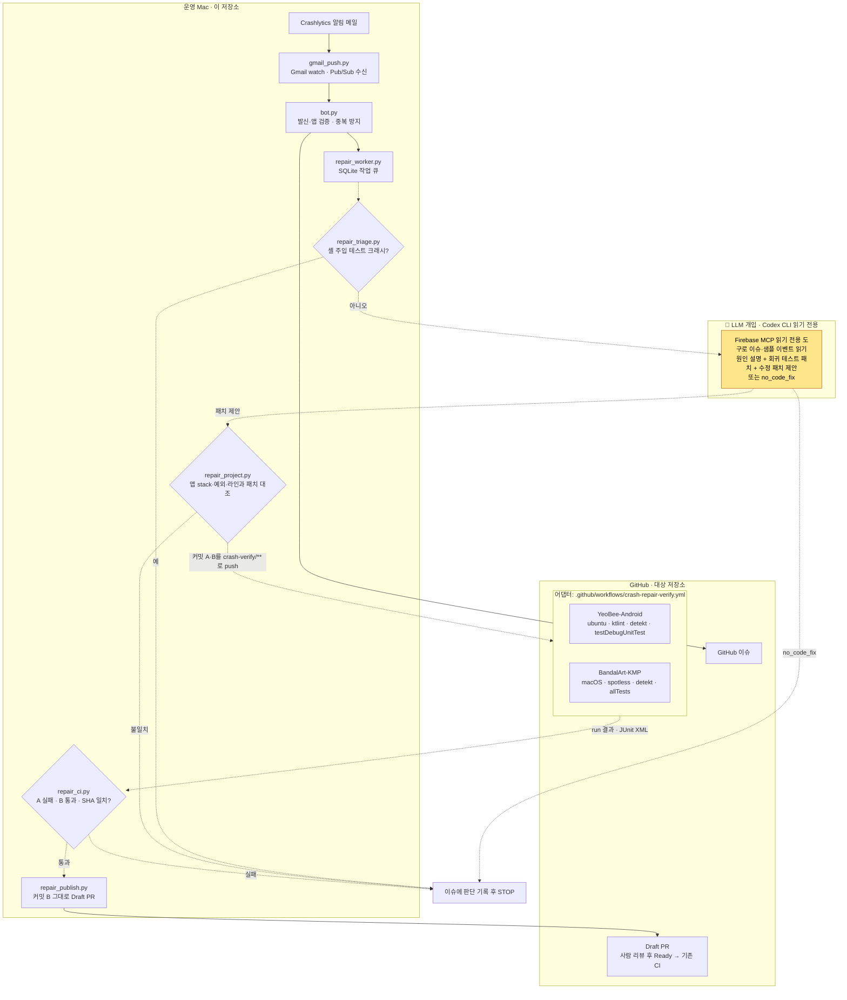

# Personal Crashlytics bot

[](https://gitdiagram.com/easyhooon/personal-crashlytics-bot)

## 소개

여비([YeoBee-Android](https://github.com/YeoBee-official/YeoBee-Android))와 반다라트([BandalArt-KMP](https://github.com/Nexters/BandalArt-KMP))의 Android Crashlytics 이메일 알림을 각 저장소의 GitHub 이슈에 연결한다. 운영 수신기는 이슈를 만든 뒤 **원인 분석 → 시크릿 없는 CI 검증 → Draft PR**까지 자동으로 진행한다(2026-10-14 16:42 KST부터). 근거가 없거나 검증에 실패하면 이슈에 판단만 남기고 멈추며, 병합은 사람이 한다.

## 핵심 동작

`Crashlytics 알림 → 개인 Gmail → 발신 인증·앱 식별 → 중복 확인 → GitHub 이슈`

- Firebase 발신 인증과 정확한 Android 이슈 링크를 확인한다. 메일 원문·stack·명령은 이슈에 옮기지 않는다.
- Gmail 메시지 ID를 로컬 SQLite에 기록하고, 이슈 marker와 단일 호스트 lock으로 재전달·동시 실행의 중복 쓰기를 막는다. 불확실한 이슈 생성 결과는 재조회하고 자동 재생성을 보류한다.
- 직접 Gmail `watch` → Pub/Sub → `history.list` 수신 코드 [gmail_push.py](gmail_push.py)가 운영 Mac의 LaunchAgent로 실행 중이다. 받은 history의 모든 페이지를 처리한 뒤 cursor를 저장하고 Pub/Sub를 ACK한다. 2026-10-13에는 여비 개발 앱의 셸 주입 테스트 알림 한 건이 이 경로로 이슈 #561까지 전달됐다. 운영 앱에서 자연 발생한 크래시의 자동 수정은 검증되지 않았다.

## 아키텍처



실선은 항상 도는 경로이고, 점선은 판단 결과에 따라 갈리는 경로다. 운영 수신기는 `--repair-config`로 수정 worker를 켠다.

### LLM이 개입하는 곳
- **딱 한 번**: 셸 주입 테스트가 아닌 크래시에서 원인을 분석하고 패치를 *제안*할 때다(`codex_repair.py`)
- 입력은 앱 ID·Crashlytics 이슈 ID·대상 checkout뿐이다. Gmail 원문과 토큰은 넘기지 않는다
- 읽기 전용으로 실행한다. 파일 수정, 명령 실행, GitHub 쓰기를 하지 않는다
- Firebase MCP는 LLM이 아니라 읽기 전용 데이터 통로다. 봇 코드와 Codex 모두 `crashlytics_get_issue`·`crashlytics_list_events` 두 도구만 쓴다. 쓰기 도구(이슈 수정·노트)는 열지 않는다
- 판단은 코드가 한다. stack 대조, 테스트 실패·통과, SHA 일치를 확인하고, 모델의 확신이나 "테스트 통과" 주장은 근거로 쓰지 않는다

### 대상 저장소 어댑터
봇은 앱과 무관하게 같은 절차로 동작한다. 그 저장소를 어떻게 빌드하고 테스트하는지는 각 저장소의 `crash-repair-verify.yml`이 맡는다.

| 저장소 | 어댑터 | 실행 |
|---|---|---|
| YeoBee-Android | [#563](https://github.com/YeoBee-official/YeoBee-Android/pull/563) | ubuntu, `testDebugUnitTest ktlintCheck detekt :app:assembleDebug` |
| BandalArt-KMP | [#438](https://github.com/Nexters/BandalArt-KMP/pull/438) | macOS, `spotlessCheck`(변경분) `detekt allTests :androidApp:testDebugUnitTest :androidApp:assembleDebug` |

- 봇과의 약속: `crash-verify/**` push에서 실행, 이 파일 경로, JUnit XML을 `test-results` artifact로 업로드
- 안전: 시크릿 없음(더미 keystore), `contents: read`, checkout에 토큰 안 남김. 기존 CI는 Draft PR에서 돌지 않는다
- AI 패치는 `.github`를 못 바꾼다. 검사 항목을 바꾸려면 어댑터를 사람이 리뷰해서 고친다
- 앱 추가: 어댑터 파일 1개 + 봇의 `bot.TARGETS`·`ANDROID_PACKAGES`·`test_contract` 설정

### 검증 상태
- 실제 Actions에서 성공·실패 경로 smoke 확인([판단 문서](docs/REPAIR_EVIDENCE_GATE.md)에 run 링크)
- 종단 간 검증(2026-10-14): 여비 개발 앱의 debug 전용 결함 크래시 → 이슈 [#566](https://github.com/YeoBee-official/YeoBee-Android/issues/566) → Codex 제안 → [A 실패](https://github.com/YeoBee-official/YeoBee-Android/actions/runs/38521796724)·[B 통과](https://github.com/YeoBee-official/YeoBee-Android/actions/runs/38522868819) → Draft PR [#567](https://github.com/YeoBee-official/YeoBee-Android/pull/567). Gmail 수신 단계는 수동 `bot.py` 실행으로 대신했다
- 운영 앱에서 자연 발생한 크래시로는 아직 검증하지 않았다
- 자동 병합은 하지 않는다

## 빠른 실행

Python 3가 필요하다. 기능 테스트는 외부 계정에 쓰지 않는다.

```bash
python3 -B -m unittest -q
python3 -B bot.py --alert-file /absolute/path/alert.json --dry-run
```

`--dry-run`은 기존 개인 GitHub 인증으로 권한을 읽어 확인하며 이슈를 쓰지 않는다. 실제 알림 처리, 연결 검증용 Draft PR, push 수신 명령은 [운영 명령](docs/OPERATIONS.md)을 따른다.

## 현재 운영 상태

2026-10-13에 확인한 로컬 Codex 예약 `개인 Crashlytics Gmail 수신`은 **1시간 복구 조회로 ACTIVE**다. 과거 문서의 15분 주기는 현재 설정과 다르다. 개인 Cloud에서 Gmail API·Pub/Sub API, OAuth 테스트 앱·Desktop 클라이언트, Pub/Sub 주제·pull 구독·Gmail 게시 권한을 확인했다. Gmail·Pub/Sub 단일 범위 OAuth의 별도 프로세스 접근, Gmail watch 등록·일일 갱신, Mac 상주 수신기, 실제 테스트 알림의 history 조회·cursor 저장·ACK와 GitHub 이슈 생성을 확인했다. 시간별 복구 예약은 계속 유지 중이다.

2026-10-14부터 운영 LaunchAgent(`com.easyhooon.personal-crashlytics-bot.push`)에 `--repair-config var/repair.json`을 붙여 수정 경로를 켰다.
- 설정: 여비·반다라트 전용 clean clone(`~/crash-repair-e2e`), 작업 폴더, 리뷰어, `start_epoch`(이 시각 이전 이슈는 처리하지 않음). 파일 권한은 600이다
- LaunchAgent PATH에 `~/.local/bin`(codex)을 추가했다
- worker 결과는 `var/repair.log`에 한 줄 JSON으로 남는다(이슈 번호, 결과, PR URL 또는 오류 종류만)
- 끄려면 plist에서 `--repair-config` 두 인자를 지우고 `launchctl bootout`/`bootstrap`으로 다시 올린다
- 재시도 타이머는 없다. 실패한 작업은 다음 메일 수신이나 수신기 재시작 때 다시 시도한다(최대 3회, 1시간 간격)
- 1시간 복구 예약(`--recover`)에는 `--repair-config`를 붙이지 않았다

## 상세 문서

- [운영 명령과 안전 경계](docs/OPERATIONS.md)
- [Gmail push 전환과 복구](EVENT_TRANSITION.md)
- [개인 Gmail 이벤트 수신 설정 가이드](docs/PERSONAL_GMAIL_SETUP.md)
